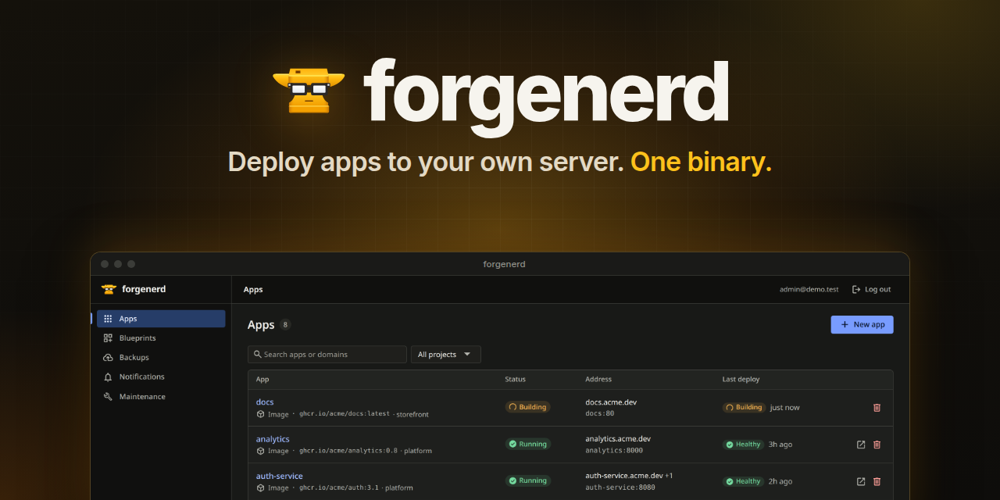

[](https://github.com/forgenerd/forgenerd/releases) [](https://github.com/forgenerd/forgenerd/commits) [](LICENSE)

<br />

## What is forgenerd?

forgenerd is an open-source, self-hosted platform for deploying **apps, databases and
services** on your own server. It is an alternative to Heroku, Render and Railway that
you run yourself.

It ships as a **single binary**. It builds and runs your apps with plain Docker, serves
them over HTTPS through Caddy and keeps its state in SQLite. The control plane idles at
a few tens of megabytes, so it fits comfortably on a 1 GB VPS.

Your apps are ordinary Docker containers on your own machine. There is no vendor, no
account to sign up for and no cloud service in the loop.

<br />

## Key features

| Area | Highlights |
| :--- | :--- |
| **Deploy** | A Docker image, a git repository (Dockerfile or Railpack) or a Compose stack, with push-to-deploy webhooks from GitHub, Gitea and GitLab |
| **Zero downtime** | New versions must pass a health check before taking traffic, and previous images are kept for one-click rollback |
| **Networking** | Automatic HTTPS for custom domains and `<app>.<your-domain>`, plus a private network where apps reach each other by name |
| **Databases** | One-click Postgres, MySQL and Redis |
| **Backups** | Scheduled backups to S3 (AWS, Cloudflare R2, Backblaze B2, MinIO) with retention and one-click restore, including the panel itself |
| **Self-healing** | Crashed or unresponsive apps are restarted, with alerts on Discord, Slack, Telegram or any webhook |
| **Security** | Secrets encrypted at rest, a strict Compose policy, no host ports published by apps and rate-limited logins |
| **API** | Everything in the panel is also available as a REST API with API tokens |

<br />

## Get started

Install forgenerd on a Linux server (x86_64 or arm64) with Docker:

```sh
curl -fsSL https://raw.githubusercontent.com/forgenerd/forgenerd/main/scripts/install.sh | sudo bash
```

Then follow the guide:

- [Requirements](docs/guide.md#requirements)
- [Install and open the panel](docs/guide.md#install)
- [Use your own domain](docs/guide.md#use-your-own-domain)
- [Deploy an app](docs/guide.md#deploy-an-app)
- [Backups](docs/guide.md#backups)
- [Upgrade and maintenance](docs/guide.md#maintenance)
- [Configuration](docs/guide.md#configuration)
- [Building from source](docs/guide.md#building-from-source)

<br />

## Resources

- [Guide](docs/guide.md)
- [Releases](https://github.com/forgenerd/forgenerd/releases)
- [Issues](https://github.com/forgenerd/forgenerd/issues)
- [Security policy](SECURITY.md)
- [License (Apache 2.0)](LICENSE)

<br />

## Star History

<p align="center">
  <a href="https://star-history.com/#forgenerd/forgenerd&Date">
    
  </a>
</p>
